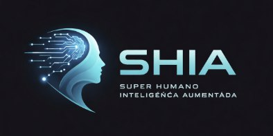

<p align="center">
  
</p>

<h1 align="center">ê°Å¸Â§Â  SHIA - Super Humanos InteligêƒÂªncia Aumentada</h1>

<p align="center">
  <strong>Talento Humano + IA = Escala, Autonomia e Resultado</strong>
</p>

<p align="center">
  <a href="#-sobre-o-curso">Sobre</a> ê¢â‚¬Â¢
  <a href="#-trilhas">Trilhas</a> ê¢â‚¬Â¢
  <a href="#-estrutura">Estrutura</a> ê¢â‚¬Â¢
  <a href="#-tecnologias">Tecnologias</a> ê¢â‚¬Â¢
  <a href="#-comeêƒÂ§ando">ComeêƒÂ§ando</a>
</p>

<p align="center">
  
  
  
  
</p>

---

## ê°Å¸Å½Â¯ Sobre o Curso

> **"A InteligêƒÂªncia Artificial nêƒÂ£o substitui o talento humano, ela o AMPLIFICA."**

O **SHIA** êƒÂ© um curso completo de **InteligêƒÂªncia Aumentada** que ensina vocêƒÂª a usar IA como amplificadora do seu talento, nêƒÂ£o como substituta.

A IA elimina barreiras têƒÂ©cnicas, estruturas caras e dependêƒÂªncia de equipes grandes, permitindo que qualquer pessoa com uma ideia clara possa transformêƒÂ¡-la em realidade.

### ê¢Å“¨ O que vocêƒÂª vai aprender

| CompetêƒÂªncia | DescriêƒÂ§êƒÂ£o |
|-------------|-----------|
| ê°Å¸Å½Â¯ **Autonomia** | Usar ferramentas de IA de forma independente |
| ê°Å¸â€™Â¡ **Clareza** | Traduzir ideias em prompts efetivos |
| ê¢Å¡Â¡ **Velocidade** | Executar projetos criativos e têƒÂ©cnicos rapidamente |
| ê°Å¸â€œË† **Escala** | Multiplicar impacto sem aumentar custos |
| ê°Å¸â€Â¥ **ConfianêƒÂ§a** | Aplicar IA em qualquer contexto profissional |

---

## ê°Å¸â€”ºê¯Â¸Â Trilhas

O curso êƒÂ© dividido em **4 trilhas progressivas**, cada uma com foco especêƒÂ­fico:

<table>
<tr>
<td width="25%" align="center">

### ê°Å¸Å¸Â¡ Trilha 0
**INTRODUêƒâ€¡êƒÆ’O**

Fundamentos de IA e Engenharia de Prompts

*ObrigatêƒÂ³ria para todos*

`10 mêƒÂ³dulos`

</td>
<td width="25%" align="center">

### ê°Å¸Å¸Â¢ Trilha 1
**ARTE**

ExpressêƒÂ£o criativa e produêƒÂ§êƒÂ£o multimêƒÂ­dia com IA

*Para artistas e criadores*

`10 mêƒÂ³dulos`

</td>
<td width="25%" align="center">

### ê°Å¸â€Âµ Trilha 2
**ENGENHARIA**

LêƒÂ³gica, automaêƒÂ§êƒÂ£o e soluêƒÂ§êƒÂµes têƒÂ©cnicas com IA

*Para desenvolvedores*

`10 mêƒÂ³dulos`

</td>
<td width="25%" align="center">

### ê°Å¸Å¸Â£ Trilha 3
**CONSULTORIA**

DiagnêƒÂ³stico, estratêƒÂ©gia e escala de negêƒÂ³cios

*Para consultores*

`10 mêƒÂ³dulos`

</td>
</tr>
</table>

---

## ê°Å¸â€œÅ¡ Estrutura do Curso

### Trilha 0: IntroduêƒÂ§êƒÂ£o (ObrigatêƒÂ³ria)

| # | MêƒÂ³dulo | DescriêƒÂ§êƒÂ£o |
|---|--------|-----------|
| 1 | ê°Å¸Å¡â‚¬ Bem-vindo êƒÂ  RevoluêƒÂ§êƒÂ£o da IA | O que êƒÂ© InteligêƒÂªncia Aumentada e por que ela êƒÂ© a verdadeira revoluêƒÂ§êƒÂ£o |
| 2 | ê°Å¸Å½Â¯ A EssêƒÂªncia da Engenharia de Prompts | A arte de conversar com a IA |
| 3 | ê°Å¸â€ºÂ ê¯Â¸Â Ferramentas e Modelos de IA | GPT-4, Claude, Gemini, Midjourney e mais |
| 4 | ê°Å¸â€œÂ Anatomia de um Prompt Perfeito | Estrutura e elementos-chave |
| 5 | ê°Å¸Å½â€œ Zero-Shot e Few-Shot Prompting | Aprendendo com poucos exemplos |
| 6 | ê°Å¸Â§Âª O Mindset da ExperimentaêƒÂ§êƒÂ£o | Como iterar e refinar seus prompts |
| 7 | ê°Å¸Å½Â¨ AlêƒÂ©m do Texto | GeraêƒÂ§êƒÂ£o de imagens, êƒÂ¡udio e cêƒÂ³digo |
| 8 | ê¢Å¡â€“ê¯Â¸Â êƒâ€°tica e Responsabilidade | Uso responsêƒÂ¡vel da IA |
| 9 | ê°Å¸â€œâ€“ Como Aprender a Aprender | Habilidades do futuro |
| 10 | ê°Å¸Ââ€  Projeto Final Integrado | AplicaêƒÂ§êƒÂ£o prêƒÂ¡tica |

### Trilha 1: Arte

| # | MêƒÂ³dulo | Foco |
|---|--------|------|
| 1 | A Nova DefiniêƒÂ§êƒÂ£o de Artista | Redefinir o papel do artista na era digital |
| 2 | Traduzindo IntenêƒÂ§êƒÂ£o em Prompts | Comunicar ideias criativas para a IA |
| 3 | CriaêƒÂ§êƒÂ£o MultimêƒÂ­dia Sem Barreiras | Produzir mêƒÂºsica, cARCKHÉ e arte |
| 4 | Desenvolvendo um Estilo êƒÅ¡nico | Criar identidade visual consistente |
| 5 | Narrativas Visuais e Storytelling | Contar histêƒÂ³rias atravêƒÂ©s de imagens |
| 6 | Ferramentas AvanêƒÂ§adas de GeraêƒÂ§êƒÂ£o | Dominar ferramentas profissionais |
| 7 | Da GeraêƒÂ§êƒÂ£o êƒÂ  PêƒÂ³s-ProduêƒÂ§êƒÂ£o | Refinar e finalizar obras |
| 8 | Arte com PropêƒÂ³sito | Aplicar arte para impacto real |
| 9 | MonetizaêƒÂ§êƒÂ£o e AudiêƒÂªncia | Transformar arte em renda |
| 10 | O Futuro da Criatividade | Refletir sobre o futuro |

### Trilha 2: Engenharia

| # | MêƒÂ³dulo | Foco |
|---|--------|------|
| 1 | Mindset do Engenheiro Aumentado | Desenvolver mentalidade de resultado (ROI) |
| 2 | DiagnêƒÂ³stico LêƒÂ³gico com IA | Usar IA como parceira de raciocêƒÂ­nio |
| 3 | Prototipagem RêƒÂ¡pida e Vibe Code | Criar soluêƒÂ§êƒÂµes funcionais rapidamente |
| 4 | AutomaêƒÂ§êƒÂ£o de Processos | Automatizar tarefas repetitivas |
| 5 | RAG na PrêƒÂ¡tica | Integrar conhecimento externo êƒÂ  IA |
| 6 | Construindo Agentes de IA | Criar assistentes autêƒÂ´nomos |
| 7 | TêƒÂ©cnicas AvanêƒÂ§adas de Prompt | Aplicar CoT, ToT, MoE |
| 8 | MediêƒÂ§êƒÂ£o e Melhoria ContêƒÂ­nua | Medir e otimizar resultados |
| 9 | IntegraêƒÂ§êƒÂ£o em AplicaêƒÂ§êƒÂµes Reais | Implementar IA em sistemas |
| 10 | GestêƒÂ£o de Projetos de IA | Escalar soluêƒÂ§êƒÂµes |

### Trilha 3: Consultoria

| # | MêƒÂ³dulo | Foco |
|---|--------|------|
| 1 | O Novo Papel do Consultor | Redefinir o papel na era da IA |
| 2 | DiagnêƒÂ³stico Inteligente | Mapear problemas com IA |
| 3 | Mapeamento de Oportunidades | Identificar onde IA gera ganho |
| 4 | EstratêƒÂ©gias Personalizadas | Criar soluêƒÂ§êƒÂµes sob medida |
| 5 | Potencializando Equipes | Empoderar pessoas |
| 6 | Formatos de Entrega | Estruturar mentorias e workshops |
| 7 | Biblioteca de Prompts | Criar ativos reutilizêƒÂ¡veis |
| 8 | Escala com AutomaêƒÂ§êƒÂ£o | Escalar sem perder o humano |
| 9 | Medindo ROI | Demonstrar resultados tangêƒÂ­veis |
| 10 | êƒâ€°tica e GovernanêƒÂ§a | Liderar com responsabilidade |

---

## ê°Å¸â€ºÂ ê¯Â¸Â Tecnologias Abordadas

### Modelos de Linguagem (LLMs)

| Modelo | Empresa | Pontos Fortes |
|--------|---------|---------------|
| GPT-4 | OpenAI | Versatilidade, raciocêƒÂ­nio complexo |
| Claude | Anthropic | Contexto longo, seguranêƒÂ§a |
| Gemini | Google | Multimodalidade, integraêƒÂ§êƒÂ£o |
| Llama | Meta | Open source, customizaêƒÂ§êƒÂ£o |

### Ferramentas Criativas

| Categoria | Ferramentas |
|-----------|-------------|
| **Imagem** | Midjourney, DALL-E 3, Stable Diffusion, Leonardo.ai |
| **êƒÂudio** | ElevenLabs, Suno, Whisper |
| **VêƒÂ­deo** | Runway, Pika Labs, Sora |
| **CêƒÂ³digo** | GitHub Copilot, Cursor, Replit AI |

### AutomaêƒÂ§êƒÂ£o e IntegraêƒÂ§êƒÂ£o

| Categoria | Ferramentas |
|-----------|-------------|
| **No-Code** | Zapier, Make, n8n |
| **Frameworks** | LangChain, LlamaIndex |
| **Produtividade** | Notion AI, Zapier AI |

---

## ê°Å¸Å¡â‚¬ ComeêƒÂ§ando

### PrêƒÂ©-requisitos

- Navegador moderno (Chrome, Firefox, Safari, Edge)
- ConexêƒÂ£o com internet
- Vontade de aprender! ê°Å¸â€Â¥

### Acessar o Curso

```bash
# Clone o repositêƒÂ³rio

<div align="center">
  
  <p><strong>Arckhé AI</strong></p>
</div>

git clone https://github.com/linnoff88-dev/SHIA.git

# Entre na pasta
cd SHIA

# Abra o curso no navegador
open curso/index.html
# ou
xdg-open curso/index.html  # Linux
```

---

## ê°Å¸â€œÂ Estrutura do Projeto

```
SHIA/
ê¢â€Å“ê¢â€â‚¬ê¢â€â‚¬ ê°Å¸â€œâ€ž README.md              # Este arquivo
ê¢â€Å“ê¢â€â‚¬ê¢â€â‚¬ ê°Å¸â€œÂ curso/                 # PêƒÂ¡ginas do curso
ê¢â€â€š   ê¢â€Å“ê¢â€â‚¬ê¢â€â‚¬ index.html           # PêƒÂ¡gina inicial
ê¢â€â€š   ê¢â€Å“ê¢â€â‚¬ê¢â€â‚¬ trilha0/             # Trilha de IntroduêƒÂ§êƒÂ£o
ê¢â€â€š   ê¢â€Å“ê¢â€â‚¬ê¢â€â‚¬ trilha1/             # Trilha de Arte
ê¢â€â€š   ê¢â€Å“ê¢â€â‚¬ê¢â€â‚¬ trilha2/             # Trilha de Engenharia
ê¢â€â€š   ê¢â€â€ê¢â€â‚¬ê¢â€â‚¬ trilha3/             # Trilha de Consultoria
ê¢â€Å“ê¢â€â‚¬ê¢â€â‚¬ ê°Å¸â€œÂ doc/                   # DocumentaêƒÂ§êƒÂ£o
ê¢â€â€š   ê¢â€Å“ê¢â€â‚¬ê¢â€â‚¬ CURSO_SHIA_COMPLETO.md
ê¢â€â€š   ê¢â€Å“ê¢â€â‚¬ê¢â€â‚¬ base/                # ConteêƒÂºdo base
ê¢â€â€š   ê¢â€â€ê¢â€â‚¬ê¢â€â‚¬ conteudo_modulos/    # MêƒÂ³dulos detalhados
ê¢â€Å“ê¢â€â‚¬ê¢â€â‚¬ ê°Å¸â€œÂ ref/                   # ReferêƒÂªncias de design
ê¢â€â€ê¢â€â‚¬ê¢â€â‚¬ ê°Å¸â€œÂ .bmad-core/           # Framework BMad Method
```

---

## ê°Å¸Å½Â¨ Sistema de Cores

| Trilha | Cor | CêƒÂ³digo | Uso |
|--------|-----|--------|-----|
| **Trilha 0** | Amarelo | `#EAB308` | IntroduêƒÂ§êƒÂ£o/Fundamentos |
| **Trilha 1** | Verde | `#10B981` | Arte |
| **Trilha 2** | Azul | `#3B82F6` | Engenharia |
| **Trilha 3** | Roxo | `#8B5CF6` | Consultoria |

---

## ê°Å¸â€œâ€“ Metodologia

O curso utiliza uma metodologia baseada em:

- **12 PrêƒÂ¡ticas de Design Instrucional** (University of San Diego)
- **10 Fases de Aprendizagem Transformacional** (Mezirow)
- **3 EstêƒÂ¡gios Centrais:** Crise Pessoal ê¢â€ â€™ ReflexêƒÂ£o ê¢â€ â€™ AêƒÂ§êƒÂ£o

### Estrutura de Cada TêƒÂ³pico

1. **ExplicaêƒÂ§êƒÂ£o Detalhada** - Conceito teêƒÂ³rico aprofundado
2. **Exemplos PrêƒÂ¡ticos de Prompts** - AplicaêƒÂ§êƒÂ£o imediata
3. **ExercêƒÂ­cios** - PrêƒÂ¡tica guiada
4. **Recursos Visuais** - InfogrêƒÂ¡ficos, diagramas, imagens

---

## ê°Å¸Â¤Â Contribuindo

ContribuiêƒÂ§êƒÂµes sêƒÂ£o bem-vindas! Sinta-se êƒÂ  vontade para:

1. Fazer um Fork do projeto
2. Criar uma Branch (`git checkout -b feature/NovaFuncionalidade`)
3. Commit suas mudanêƒÂ§as (`git commit -m 'Adiciona nova funcionalidade'`)
4. Push para a Branch (`git push origin feature/NovaFuncionalidade`)
5. Abrir um Pull Request

---

## ê°Å¸â€œÅ“ LicenêƒÂ§a

Este projeto estêƒÂ¡ sob a licenêƒÂ§a MIT. Veja o arquivo [LICENSE](LICENSE) para mais detalhes.

---

## ê°Å¸â€œÂ¬ Contato

- **GitHub:** [@linnoff88-dev](https://github.com/linnoff88-dev)
- **Email:** linnoff88-dev@gmail.com

---

<p align="center">
  <strong>IA nêƒÂ£o pensa por vocêƒÂª. IA AMPLIFICA quem vocêƒÂª êƒÂ©.</strong>
</p>

<p align="center">
  Feito com ê°Å¸Â§Â  e ê¢ÂÂ¤ê¯Â¸Â pelo time SHIA
</p>

---

<div align="center">
  
  <p><strong>Arckhé AI</strong></p>
</div>